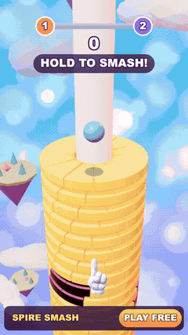
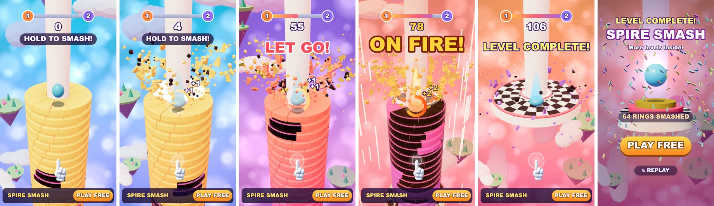

# Spire Smash — 3D playable ad, собранный ИИ-пайплайном

**▶ Играть в браузере / с телефона:** https://bankaino.github.io/spire-smash-playable/
(A/B-варианты: [big_fire](https://bankaino.github.io/spire-smash-playable/big_fire.html) · [late_wow](https://bankaino.github.io/spire-smash-playable/late_wow.html) · [risky](https://bankaino.github.io/spire-smash-playable/risky.html))

<p align="center"><br><sub>демо-прогон бота, 14 с · <a href="docs/media/gameplay.mp4">MP4 в лучшем качестве</a></sub></p>

Портретная 3D playable-реклама в жанре аркадного «спуска по башне»: зажимаешь палец — шар пробивает вращающиеся кольца вниз, отпускаешь — отскакивает; чёрные сегменты разбивают шар, но серия пробитых колец **раскаляет шар**, и в огне он сметает даже чёрное. Сделана **по мотивам Stack Ball** (чужая игра — в репозиторий не включена): механика та же, а название, палитра, интерфейс, код и весь визуальный стиль — свои. Весь арт **процедурный**: ни одной сгенерированной картинки и ни одной внешней 3D-модели, единственный растровый файл — рука-подсказка (7 KB). Весь путь от референса до билдов под рекламные сети пройден с **Claude Code** (план, код, симуляция) на three.js.



## Что внутри за ~12 секунд

| время (демо-прогон) | бит | что видит игрок |
|---|---|---|
| 0–1.4 с | хук | шар уже прыгает на верхнем кольце, рука и «HOLD TO SMASH!». В рекламном режиме до первого касания (≤ 2 с) **«призрачный палец» сам пробивает кольца**, чтобы глагол был виден без текста; он никогда не считается вводом игрока |
| 1.4 с | первая награда | кольцо разлетается на конфетти, счёт растёт, тон звука поднимается с каждым кольцом в серии (пентатоника, две октавы) |
| 1.7 с | нагрев | вокруг шара появляется дуга серии: кольцо заполняется с каждым пробитым кольцом, «KEEP GOING!» |
| 2.2–4.8 с | **вау: огонь** | 8 колец подряд — «ON FIRE!»: вспышка, стоп-кадр 80 мс, камера расширяется, шар раскаляется, 2.6 с он пробивает и чёрное |
| 5.1 с | обучение правилу | первый раз, когда шар летит на чёрное: замедление и «LET GO!» (один раз за игру) |
| 7.3–9.9 с | вторая серия | кольца 48–59 почти целиком чёрные — «стена»; чтобы пройти её, нужен второй огонь, который снова набирается в чистой зоне перед ней |
| ~10 с | финиш | подиум с шахматным верхом, конфетти, «LEVEL COMPLETE!» |
| 11.9 с+ | эндкард | заголовок по результату, 3D-подиум с прыгающим шаром, PLAY FREE (весь экран — CTA) |

Принципы из практики плейаблов: одно касание; награда ≤ 8 с после первого действия; **кнопка стора видна всё время**; на каждое действие — отклик (тряска, FOV-удар, частицы, звук, вспышка); проигрыш — тоже эндкард, без жёсткого фейла (две жизни; после смерти нужно сначала отпустить палец: «RELEASE ON BLACK!»); рука возвращается после 2.5 с простоя.

**Что, если зритель ничего не трогает?** До 2 с играет призрачный палец, потом шар прыгает на месте, а на 8-й секунде без касаний показывается эндкард «KEEP SMASHING!» (статистика колец показывается, если пробито не меньше 5). Зажатый и «потерянный» палец (отмена касания, потеря фокуса) отпускается автоматически.

### Чем это лучше референса

| у оригинала | здесь |
|---|---|
| пустой градиентный фон, нет ощущения скорости | небо меняет цвет с глубиной (голубой → сиреневый → закат), парящие острова и облака с параллаксом, боке, звёзды на глубине |
| плоский свет, «картонные» кольца | скошенные кольца, ambient-occlusion у столба, env-map, тональная компрессия (ACES), розовая контровая подсветка |
| чёрные сегменты просто тёмные | глянцевый «обсидиан» с отражениями и розовой кромкой, которая пульсирует, когда шар летит на опасность |
| разлом без последствий | конфетти-осколки (40 на кольцо), вспышка и кольца-волны, тряска и FOV-удар камеры, сплющивание шара, дуга серии |
| огонь — оранжевый шлейф | шар раскаляется, пламя, линии скорости по краям, расширение угла, тёплая виньетка, вспышка, звуковая «мелодия» вместо одной ноты |
| финиш — плоский круг | подиум с шахматным верхом, трёхъярусный пьедестал на эндкарде, ореол, конфетти |

## Билды под рекламные сети — одной командой

```bash
python tools/build_playable.py --variant all
```

Каждый билд — **один HTML-файл** без внешних запросов: three.js (tree-shaken), код и адаптер сети.

| сеть | размер | лимит | CTA / жизненный цикл |
|---|---|---|---|
| AppLovin | 0.78 MB | 5 MB | MRAID `mraid.open` |
| Unity Ads | 0.78 MB | 5 MB | MRAID |
| ironSource | 0.78 MB | 5 MB | DAPI `openStoreUrl` |
| Mintegral | 0.78 MB | 5 MB | `install()`, `gameReady()`, `gameEnd()` |
| Google Ads | 0.22 MB (zip) | 5 MB | `ExitApi.exit()` |
| Meta | 0.78 MB | 2 MB | `FbPlayableAd.onCTAClick()` |

Звук выключается, когда реклама не видна (MRAID `viewableChange` / DAPI `audioVolumeChange`) и стартует только после первого касания (автоплей браузеров). Полный отчёт: [docs/build-report.md](docs/build-report.md).

## Бюджет и оптимизация

| что | значение | как |
|---|---|---|
| вес | **0.78 MB** | three.js 713 KB (tree-shaken из 830 KB), код 45 KB, рука 7 KB, моделей и звуковых файлов **0** |
| draw calls | **12–26** | кольца — три `InstancedMesh` (цветные, чёрные, кромка), рисуется окно из 22 ближайших колец; обломки, чипсы, вспышки — пулы инстансов |
| треугольники | **≤ 114k** (вместе с тенями) | один свет с тенями, 1024 px, бокс ±5 м вокруг шара |
| небо | 1 полноэкранный проход, 3 выборки из текстуры | боке и звёзды запечены в тайлящуюся текстуру 256×512 (раньше — цикл по пикселю; по замеру на M4 он стоил ~4 мс на кадр; повторный замер я не делал) |
| разрешение | кап DPR 1.5 | экономия на телефонах с DPR 3 |
| звук | **0 байт** | процедурный WebAudio (`live/audio.js`) |
| FPS | **61** в мобильном вьюпорте 390×844 | замер на десктопном железе, см. «границы» |

Экран заполняется на любом телефоне: ширина вида 1080, высота следует соотношению сторон устройства (16:9 … 19.5:9), HUD раскладывается от высоты.

## A/B-гипотезы

Вариант = JSON с гипотезой и переопределением параметров (`variants/*.json`), билдится той же командой (сборка применяет `K`-переопределения, затем пересобирает уровень). Цифры — модель «казуального» игрока (см. ниже), не реальные данные:

| вариант | параметры | гипотеза | модель: победа / проигрыш |
|---|---|---|---|
| `default` | — | база: огонь почти сразу, средняя сложность | 68% / 32% |
| `big_fire` | `FIRE_T 3.6` | огонь дольше — «супергеройский» режим. *Сила против вызова* | 100% / 0% |
| `late_wow` | `FIRE_N 12` | огонь только после длинной серии: «вау» заслужено, а не дано. *Заработанное против мгновенного* | 42% / 58% |
| `risky` | `ROT 1.9`, `LIVES 1` | быстрее вращение, одна жизнь: больше напряжения и «SO CLOSE!». *Кликают ли проигравшие* | 50% / 50% |

## Как проверяется качество

- **Детерминированная симуляция** (`live/sim.js`, 120 Гц): всё — состояние и события; демо-прогон проверяется headless (`SIM.demoCheck`): первый удар ≤ 2.5 с, осознанные паузы перед чёрным, **два огня**, ≥ 4 чёрных кольца разбито в огне, финиш ≤ 20 с, ни одной смерти, эндкард ≤ 21 с; пассивный зритель доходит до эндкарда.
- **Игроки-боты** (`tools/player_policies.js`, ~1 с): демо-бот по 18 комбинациям старта и скорости вращения (все битами в окне) и модель казуального игрока — задержка реакции 0.15–0.35 с, широкий запас у чёрного, старт с запозданием, 72 прогона на вариант:

  ```
  variant        demo (18 runs)                     casual model (72 runs)
  big_fire       18/18 ok, fire 2.6 s, finish 9.6 s win 100% · lose 0% · timeout 0% · fire seen 100% · died ≥1 0% · median end 11.4 s
  default        18/18 ok, fire 2.6 s, finish 11.0 s win 68% · lose 32% · timeout 0% · fire seen 100% · died ≥1 51% · median end 12.7 s
  late_wow       18/18 ok, fire 11.2 s, finish 13.8 s win 42% · lose 58% · timeout 0% · fire seen 42% · died ≥1 58% · median end 10.6 s
  risky          18/18 ok, fire 2.6 s, finish 11.9 s win 50% · lose 50% · timeout 0% · fire seen 100% · died ≥1 50% · median end 12.3 s
  ```
- **Smoke-тест** (`tools/smoke_test.mjs`): открывает собранный HTML в мобильном вьюпорте с заглушкой MRAID, зажимает палец на несколько секунд, тапает CTA; проверяет — нет ошибок, нет внешних запросов, счёт растёт, CTA вызывает `mraid.open`, FPS ≥ 50.
- **Профайл сцены** (`probe.mjs`): draw calls, треугольники, размер героя в % экрана и **наложения/выходы HUD** на 10 QA-состояниях (старт, первый удар, предупреждение, нагрев, огонь, чёрное в огне, смерть, финиш, два эндкарда).

## ИИ-пайплайн

1. **Разбор референса** (4 скриншота Stack Ball + описание) → решения: механика hold-to-smash + огненный шар, свой бренд, полный цикл с эндкардом, гладкие кольца (не воксели), всё процедурно.
2. **План** (`study/SPEC.md`) написал Claude Opus 5.5: правила, зоны башни, стиль, HUD, пять фаз с критериями готовности. **Реализовал** по нему Claude Sonnet 5.5.
3. **Правила** подбирались не на глаз: параметры башни и огня — перебором через headless-ботов, пока тайминги не стали устойчивыми к фазе вращения.
4. **Мир и вид**: процедурная геометрия на three.js, стиль в `art/style_bible.txt`, живое превью с hot-reload; все кадры смотрятся только в контрольных точках, остальное — числа.
5. **Проверка**: боты, smoke, probe, QA HUD → правки → варианты → билды.

Весь пайплайн — от референса до билдов — пройден **собственными скиллами для Claude Code**.

## Запуск локально

```bash
python -m http.server 8000      # из корня репозитория
# http://localhost:8000/live/index.html?ad=1  — живая версия (рекламный режим, с призрачным пальцем)
# http://localhost:8000/live/index.html       — авто-демо (attract), любое касание — играть
python tools/build_playable.py --variant all --pages docs   # билды + демо для GitHub Pages
PLAYWRIGHT=<путь к playwright> node tools/smoke_test.mjs dist/default/applovin.html   # нужен Playwright
node tools/player_policies.js   # боты-игроки (нужен только Node)
```

## Структура

```
live/        игра: sim.js (правила, 120 Гц), scene.js (3D-мир), hud.js (Canvas2D-интерфейс), audio.js, kit.js, vendor/three.min.js, index.html
tools/       build_playable.py, build.json (название, ссылки стора, картинки), smoke_test.mjs, player_policies.js
variants/    A/B-гипотезы
art/         style bible
study/       SPEC.md (план для исполнителя), PLAN.md (решения и журнал фаз)
docs/        демо для GitHub Pages, медиа, отчёт по билдам
licenses/    лицензия three.js (MIT)
```

## Честно о границах

Ссылки на стор — заглушки (`com.example.spiresmash`); билды проверены в headless-браузере с заглушкой MRAID, **не** на физическом телефоне и не внутри настоящего SDK сети. «61 FPS» — десктопное железо с ограничением по vsync, на слабом Android цифры будут другими; тяжёлый шейдер неба я убрал, но реальные замеры на устройстве нужны. Звук процедурный и на слух не проверялся. Цифры «победа / проигрыш» — модель небрежного игрока, а не данные живых людей: она годится, чтобы сравнивать варианты между собой, а не чтобы предсказывать конверсию.

*Референс — чужая игра, в репозиторий не включён. Название, бренд, интерфейс, код и весь вид — свои; three.js — MIT (см. `licenses/`).*
